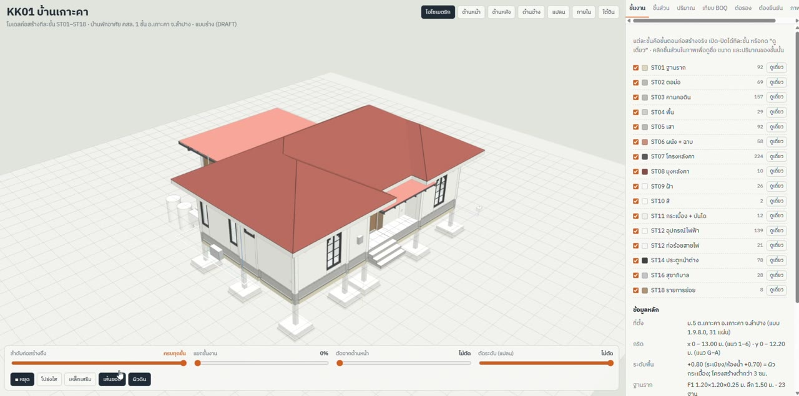
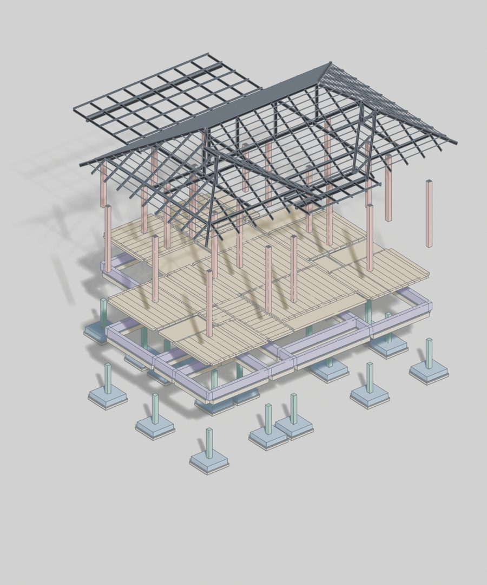
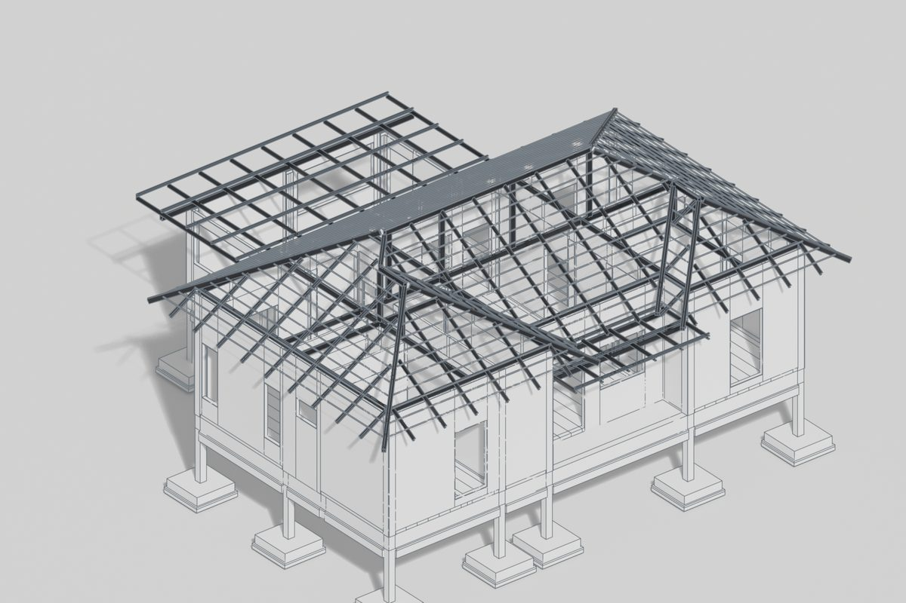
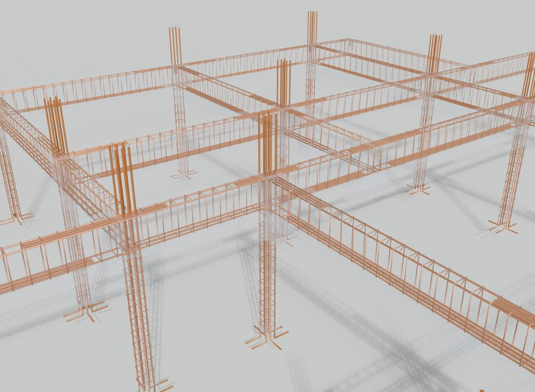
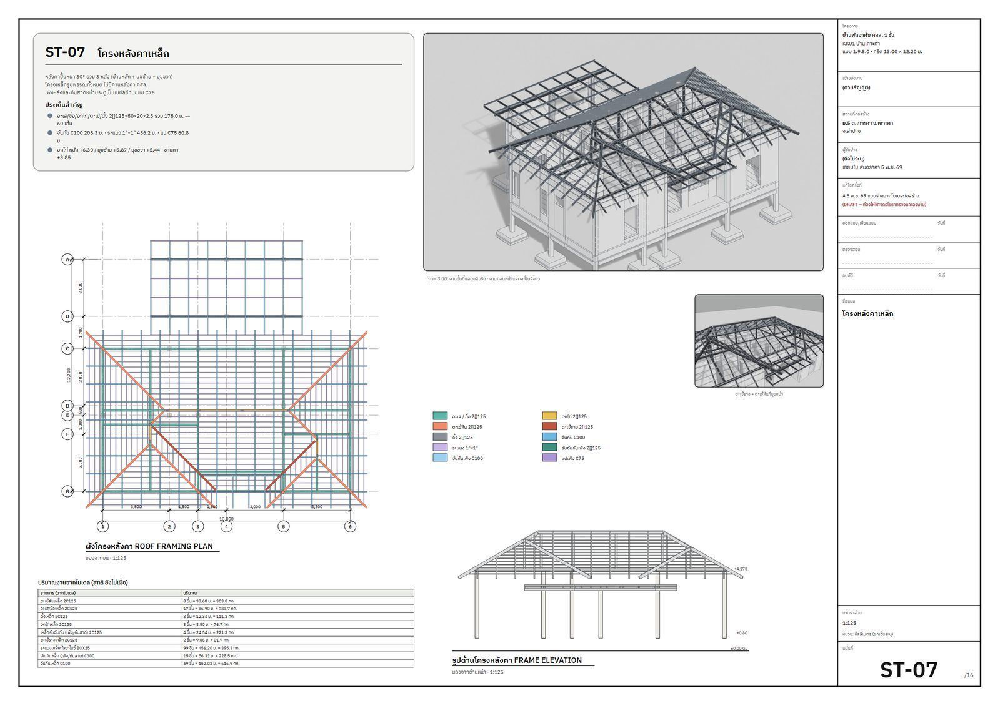
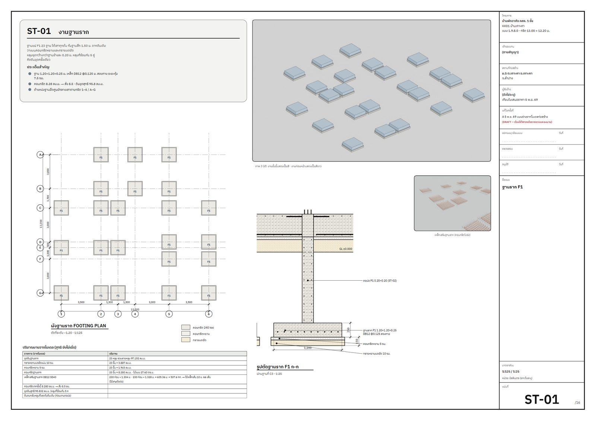

# thunder-house ⚡🏠

**Claude skill** สำหรับต่อยอดโมเดลก่อสร้างบ้านที่ปั้นทีละขั้นใน Blender ให้กลายเป็นงานที่คนอื่นใช้ได้จริง —
หน้าเว็บ 3D ให้ลูกค้า/ทีมดู, การเทียบใบเสนอราคาผู้รับเหมากับปริมาณจริงพร้อมจุดต่อรอง, และชุดแบบก่อสร้าง A3 ภาษาไทยพร้อมภาพ render

*A Claude skill that turns a stage-by-stage Blender construction model (footings → roof → MEP) into a shareable 3D web viewer,
a line-by-line contractor-BOQ comparison with negotiation points and an Excel workbook, and a Thai A3 construction drawing set with presentation renders.*

## วิดีโอตัวอย่าง (40 วินาที)

[](media/1106.mp4)

คลิกภาพเพื่อเปิดวิดีโอ [`media/1106.mp4`](media/1106.mp4) — เลื่อนดูลำดับก่อสร้าง ST01–ST18, โหมดโปร่งใส/เหล็กเสริม,
คลิกดูข้อมูลชิ้นส่วน, แท็บปริมาณงาน และแกลเลอรีภาพ render
(ตัวเลขใบเสนอราคาผู้รับเหมาในวิดีโอถูกเบลอไว้)

## ทำอะไรได้บ้าง

| ส่วน | ผลลัพธ์ |
|---|---|
| **1. หน้าเว็บ 3D** | three.js viewer: ชั้นงาน ST01–ST18 เปิด-ปิด/ดูเดี่ยว, เล่นลำดับก่อสร้าง, แยกชั้น, ตัดหน้าตัด/ตัดระดับ, เหล็กเสริม, คลิกชิ้นส่วนดูขนาด-ปริมาณ, แท็บ ปริมาณ / เทียบ BOQ / ต่อรอง / ต้องยืนยัน / ภาพ render · รองรับมือถือและ dark mode · ส่งออกเป็น HTML ไฟล์เดียวสำหรับส่งต่อ |
| **2. เทียบ BOQ + ต่อรอง** | อ่านใบเสนอราคา PDF ของผู้รับเหมา ตรวจ จำนวน × ราคา ทุกบรรทัด → เทียบกับปริมาณจากโมเดล (+ อัตราเผื่อมาตรฐาน) → คิดมูลค่าด้วยราคาต่อหน่วยของผู้รับเหมาเอง → 4 กลุ่ม: ต้องได้ตามแบบ / รายการที่ขาด / เผื่อเกิน / ของที่ขอเพิ่ม · Excel 5 แผ่น สูตรจริง |
| **3. ชุดแบบ A3** | 1 แผ่นต่อ 1 ขั้นงาน (ฐานราก ตอม่อ คาน พื้น เสา ผนัง โครงหลังคา มุงหลังคา ฝ้า สี กระเบื้อง ไฟฟ้า ประตูหน้าต่าง สุขาภิบาล รายการย่อย): ผัง รูปตัด รูปด้าน ตารางปริมาณ ทุกเส้นสร้างจากรูปทรงในโมเดล + ภาพ render EEVEE ขั้นปัจจุบันสีเด่น ขั้นก่อนหน้าสีขาว |

<p>



</p>
<p>


</p>

## ต้องมีก่อน

- โมเดลก่อสร้างทีละขั้นจาก **Workflow B ของ skill `nuea-ai-blender-house`** (`Construction/<PROJ>_Construction.blend`
  ที่ build ผ่าน selfcheck แล้ว + log ของการ build) — skill นี้ใช้ loader ของโปรเจกต์นั้น (`_obj_boxes`, `_world_bars`, ชื่อ collection)
- Blender 5.x (EEVEE + Freestyle) · Python 3 + `Pillow`, `PyMuPDF` (fitz), `openpyxl` · Google Chrome หรือ Microsoft Edge
  (แปลง HTML → PDF ภาษาไทย) · Microsoft Excel (คำนวณสูตรใหม่บน Windows)

## ติดตั้ง

**Claude Code** — คัดลอกโฟลเดอร์ `thunder-house/` ไปไว้ที่ `~/.claude/skills/thunder-house/`

```bash
git clone https://github.com/alongkorn271-lgtm/thunder-house.git
cp -r thunder-house/thunder-house ~/.claude/skills/
```

**claude.ai** — Settings → Skills → **+ Add** แล้วอัปโหลด [`dist/thunder-house.skill`](dist/thunder-house.skill)

จากนั้นพูดกับ Claude ได้เลย เช่น *"ทำ artifact ให้คนดูโมเดล"*, *"เทียบ BOQ ผรม. กับโมเดล"*, *"ต่อราคาผู้รับเหมา"*,
*"เขียนแบบจากโมเดลตามขั้นงาน"* — skill จะถูกเรียกเอง

## โครงสร้าง

```
thunder-house/
├── SKILL.md                     ลำดับงาน 6 ขั้น + บทเรียนจากงานจริง
├── references/
│   ├── boq_negotiation.md       วิธีเทียบ BOQ ผู้รับเหมา อัตราเผื่อ กับดักหน่วย 4 กลุ่มต่อรอง
│   ├── drawing_sheets.md        ผังพื้นที่แผ่น A3 วิธีวางข้อความชี้ เลือกระนาบตัดจากโมเดล
│   └── project_config.md        จุดที่ต้องแก้เมื่อใช้กับโปรเจกต์ใหม่
└── scripts/
    ├── blender/   export_model_json.py · render_sheets.py
    ├── viewer/    template.html · build_site.py · make_offline.py
    ├── boq/       boq_parse.py · make_xlsx.py · recalc_excel.ps1
    └── drawings/  make_sheets.py · sheets_late.py · render_pdf.py · lib/dwg_lib.py + ฟอนต์
```

## หมายเหตุ

- สคริปต์เป็นตัวที่ใช้งานจริงกับบ้านตัวอย่าง (KK01 บ้านพักอาศัย คสล. 1 ชั้น) — ใช้กับบ้านหลังอื่นให้แก้ตาม `references/project_config.md`
- ตัวเลขใบเสนอราคาและจุดต่อรองในไฟล์เป็น **ค่าตัวอย่าง** ไม่ใช่ราคาจริง
- แบบที่ได้เป็น **แบบร่าง (DRAFT)** — งานโครงสร้างต้องให้วิศวกรโยธาที่มีใบอนุญาตตรวจและลงนามก่อนใช้ก่อสร้าง
- ฟอนต์ IBM Plex Sans Thai ใช้สัญญาอนุญาต SIL Open Font License (`scripts/drawings/lib/fonts/OFL-LICENSE.txt`)
